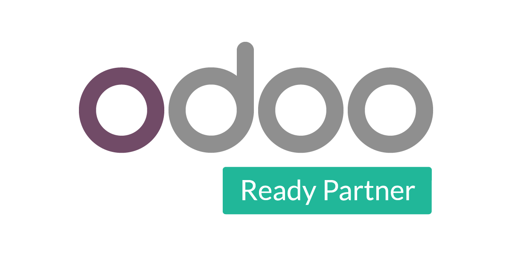

# Hola, soy Jonathan 👋

**Desarrollador con enfoque DevOps · Python, JavaScript y TypeScript**  
**Partner oficial de Odoo — categoría Ready**

Combino desarrollo de software, automatización e infraestructura en la nube. Mi enfoque es conectar el código con su despliegue y operación, con procesos reproducibles y un uso ordenado de Git.

## DevOps y nube

- **Git y GitHub:** control de versiones, gestión de ramas y colaboración mediante revisión de cambios.
- **Automatización y CI/CD:** scripts con Python y flujos de GitHub Actions.
- **AWS y Google Cloud:** infraestructura y despliegue de aplicaciones en la nube.
- **Linux, Docker y Kubernetes:** entornos de ejecución, contenedores y orquestación.

## Desarrollo

| Área | Tecnologías principales |
| --- | --- |
| Lenguajes | **Python**, **JavaScript** y **TypeScript** |
| Backend y APIs | **FastAPI**, **Express** y Node.js |
| Frontend | **Astro** con **React**, HTML y CSS |
| Datos | PostgreSQL |
| Aplicaciones empresariales | **Odoo** |

También manejo Django, NestJS, Next.js, Firebase, Tailwind CSS, GitHub Pages y Markdown. Me interesan el hardware y la relación entre el software y la infraestructura que lo sostiene.

---

<h2 align="center">Partner oficial de Odoo</h2>

  

  <strong>READY PARTNER</strong> 
  Desarrollo e integración de aplicaciones empresariales con Odoo.

Soy **partner oficial de Odoo, en la categoría Ready**. Odoo forma parte de mi enfoque de desarrollo e integración de aplicaciones empresariales, junto con Python, APIs y servicios en la nube.

---

## Contacto

